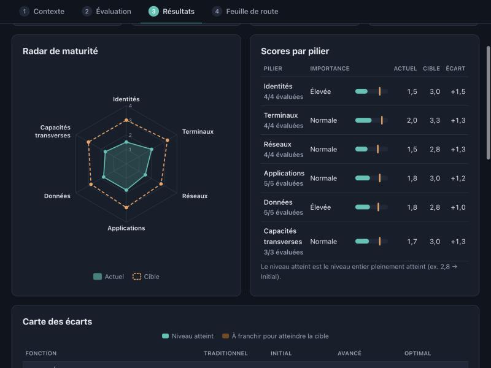

# Boussole Zero Trust

Un outil pour mesurer où en est une organisation sur le Zero Trust, et en tirer une feuille de route concrète.

👉 **[Tester l'outil en ligne](https://kelyan1.github.io/boussole-zero-trust/)**. Rien à installer, il suffit de cliquer sur « Charger l'exemple » pour voir une évaluation complète.

| Évaluation | Résultats | Feuille de route |
| --- | --- | --- |
|  |  |  |

## Pourquoi ce projet

En mission de conseil, j'ai participé à des diagnostics de maturité Zero Trust. Le déroulé est toujours le même. On fait des entretiens avec les équipes, on note des constats un peu partout, puis on passe des heures sur Excel et PowerPoint pour en faire quelque chose de présentable à un RSSI.

J'ai voulu voir si on pouvait faire tenir tout ça dans un seul outil. On mène l'entretien, on note les niveaux, et on obtient directement les scores, les écarts et un plan d'action chiffré.

Je me suis appuyé sur le [modèle de maturité Zero Trust de la CISA](https://www.cisa.gov/zero-trust-maturity-model) (v2.0), que j'ai adapté en français. Il couvre 5 piliers (identités, terminaux, réseaux, applications, données) et 3 sujets transverses, soit 25 points à évaluer sur 4 niveaux, de « Traditionnel » à « Optimal ».

## Comment ça marche

1. On commence par décrire l'organisation, sa taille, son périmètre et les piliers qui comptent le plus pour le métier.
2. On mène ensuite l'entretien. Pour chaque point, l'outil propose 3 questions à poser, et le guide s'imprime pour prendre des notes en atelier.
3. On note le niveau actuel et le niveau visé, avec les constats et les projets déjà en cours.
4. L'outil calcule un score global, trace un radar actuel/cible et liste les écarts.
5. Il propose enfin une feuille de route en 3 phases (0-6 mois, 6-18 mois, 18-36 mois), avec une estimation de charge et de budget.

Chaque action est rattachée aux mesures de l'article 21.2 de **NIS2** et au **NIST CSF 2.0**. C'est souvent la première question d'un RSSI, savoir en quoi ça aide pour la conformité.

J'ai aussi fait attention à quelques détails. L'ordre des chantiers est respecté, par exemple la micro-segmentation n'arrive jamais avant la cartographie des flux. Les projets déjà lancés sont déduits du budget, pour ne pas surestimer ce qu'il reste à engager. Et une évaluation peut s'exporter en PDF pour le rapport, ou en JSON pour la reprendre plus tard.

## Les règles de calcul

| Élément | Règle |
| --- | --- |
| Score d'un pilier | Moyenne des niveaux évalués (de 1 à 4) |
| Score global | Moyenne des piliers, pondérée selon leur importance pour le métier |
| Actions | Une action par niveau à franchir entre l'actuel et la cible |
| Phasage | Initial en phase 1, Avancé en phase 2, Optimal en phase 3. Un pilier jugé prioritaire avance d'une phase |
| Charge | 15, 30 ou 60 jours/homme selon le niveau, ajustés selon la difficulté du sujet et la taille de l'organisation |
| Budget | Charge × TJM, hors licences et matériel. C'est un ordre de grandeur à affiner en atelier |

## La sécurité de l'outil lui-même

Une évaluation de maturité liste les faiblesses d'une entreprise, ce serait gênant qu'elle fuite. J'ai donc essayé d'appliquer à l'outil ce que je recommanderais à un client.

- Tout reste dans le navigateur. Il n'y a pas de serveur et aucune donnée n'est envoyée nulle part.
- Je n'utilise aucune bibliothèque externe, ce qui supprime le risque lié à la chaîne d'approvisionnement. Même le radar est dessiné à la main en SVG.
- Une politique CSP stricte bloque les scripts et les connexions non prévus.
- Les fichiers importés sont vérifiés avant d'être chargés (champs attendus, types, tailles).

## Ce que l'outil ne fait pas (encore)

- Il ne mesure pas un taux de conformité NIS2. Il indique seulement quelles actions y contribuent, et plusieurs mesures comme la formation ou la chaîne d'approvisionnement dépassent de toute façon le Zero Trust.
- Les sujets transverses (visibilité, automatisation, gouvernance) sont évalués une seule fois pour toute l'organisation, et non pilier par pilier comme le fait la CISA. C'est un choix pour garder un atelier de durée raisonnable.
- La charge n'est pas lissée selon la capacité des équipes. La phase 2 est souvent chargée et demande à être rééquilibrée.
- Les barèmes de charge sont mes propres hypothèses, pas des références de marché.
- Les données sont stockées en clair dans le navigateur. Sur un poste partagé, mieux vaut cliquer sur « Réinitialiser » en fin de session.

Pour la suite, j'aimerais ajouter la comparaison entre plusieurs filiales, des correspondances avec DORA et l'ISO 27001, et un export Excel/PowerPoint.

## Lancer le projet en local

Il n'y a rien à installer, un petit serveur web suffit.

```bash
python3 -m http.server 8731 --bind 127.0.0.1
```

Ouvrez ensuite <http://localhost:8731>. Les tests du moteur de calcul se lancent sur <http://localhost:8731/tests/> ou avec `node tests/node.mjs`. Ils tournent aussi automatiquement sur GitHub à chaque modification.

<details>
<summary>Organisation des fichiers</summary>

```
index.html            Page principale
css/styles.css        Styles (thème clair/sombre, impression)
js/data/ztmm.js       Référentiel des piliers, niveaux et liens NIS2 / NIST CSF
js/data/guide.js      Guide d'entretien
js/engine.js          Calcul des scores, du phasage et du budget
js/app.js             Interface
js/radar.js           Radar SVG
js/data/demo.js       Organisation fictive pour la démo
tests/                Tests du moteur de calcul
```
</details>

---

Projet personnel, non affilié à la CISA. Les correspondances réglementaires et les estimations de charge sont indicatives. Licence [MIT](LICENSE).
