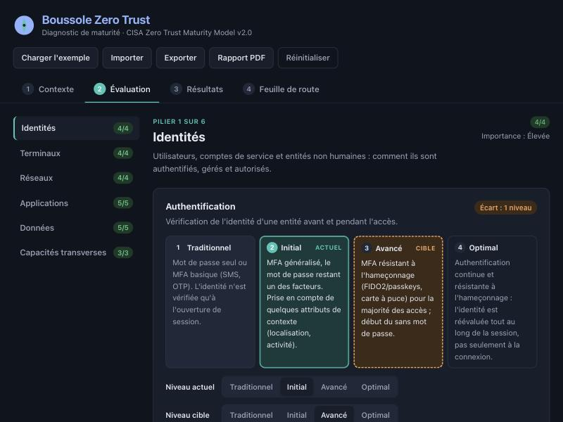

# Boussole Zero Trust

**Outil open source d'évaluation de maturité Zero Trust** : diagnostic par fonction, analyse d'écarts, feuille de route phasée et chiffrée, rattachée aux exigences **NIS2** et au **NIST CSF 2.0**.

Référentiel adapté du [CISA Zero Trust Maturity Model v2.0](https://www.cisa.gov/zero-trust-maturity-model) : 5 piliers (identités, terminaux, réseaux, applications, données), 3 capacités transverses, 25 fonctions, 4 niveaux de maturité.

> J'ai conduit des diagnostics de maturité Zero Trust en mission de conseil. Cet outil industrialise la démarche : il transforme des constats d'entretien en scores, en carte des écarts et en feuille de route présentable à un RSSI.

| Évaluation | Résultats | Feuille de route |
| --- | --- | --- |
|  |  |  |

## Fonctionnalités

- **Contexte** : organisation, périmètre, taille, TJM, et **pondération métier** de chaque pilier.
- **Guide d'entretien** : pour chaque fonction, l'enjeu Zero Trust et 3 questions à poser en atelier (75 au total), imprimable avec des cases de niveau et une zone de prise de notes.
- **Évaluation** : pour chaque fonction, niveau actuel, niveau cible, **initiative existante** (projet en cours, planifié, à adapter), constats et preuves. Les 4 niveaux sont décrits concrètement (ex. « MFA résistant à l'hameçonnage : FIDO2/passkeys »).
- **Résultats** : score global pondéré, radar actuel/cible, scores par pilier, carte des écarts fonction par fonction.
- **Feuille de route** : actions générées automatiquement, réparties sur 3 phases (0-6, 6-18, 18-36 mois), avec charge en jours/homme, gains rapides et priorités métier.
- **Prérequis entre chantiers** : une action n'est jamais planifiée avant celles dont elle dépend (ex. micro-segmentation après la cartographie des flux), et les incohérences de cibles sont signalées.
- **Budget réaliste** : le budget total distingue la part déjà couverte par les projets existants du **budget restant à engager**.
- **Conformité** : chaque action est rattachée aux mesures de l'**article 21.2 de NIS2** et aux catégories du **NIST CSF 2.0**, avec le nombre d'actions qui contribuent à chaque mesure NIS2.
- **Rapport PDF** via l'impression du navigateur, **export/import JSON** pour reprendre une évaluation.
- **Exemple fictif** chargeable en un clic pour une démonstration.

## Méthode

| Élément | Règle |
| --- | --- |
| Score d'un pilier | Moyenne des niveaux des fonctions évaluées (1 à 4) |
| Score global | Moyenne des piliers **pondérée** par l'importance métier (faible / normale / élevée) |
| Niveau atteint | Niveau entier pleinement atteint (2,8 → Initial) |
| Actions | Une action par niveau à franchir entre l'actuel et la cible |
| Phasage | Initial → phase 1, Avancé → phase 2, Optimal → phase 3 ; un pilier d'importance élevée avance d'une phase, sans jamais viser Optimal en phase 1 |
| Prérequis | Une marche vers le niveau N attend la marche des prérequis vers un niveau ≤ N ; le report se propage aux marches suivantes |
| Priorité | Importance métier, puis gains rapides, puis taille de l'écart ; un prérequis reste toujours listé avant l'action qui en dépend |
| Charge | Base 15 / 30 / 60 j/h (Initial / Avancé / Optimal) × effort de la fonction (1 à 3) × taille (PME ×0,5, ETI ×1, GE ×2) |
| Budget | Charge × TJM, hors licences et matériel : ordre de grandeur à affiner en atelier |
| Existant | Un projet en cours ou planifié et budgété couvre 100 % de la prochaine marche, un existant à adapter 50 % ; le reste constitue le budget à engager |

## Sécurité dès la conception

Une évaluation de maturité décrit les faiblesses d'une organisation : c'est une donnée sensible. L'outil est conçu en conséquence :

- **Aucun serveur, aucune requête sortante** : tout est calculé dans le navigateur, les données restent en stockage local.
- **Zéro dépendance** : pas de framework ni de bibliothèque tierce, donc pas de risque de chaîne d'approvisionnement. Le radar est dessiné en SVG natif.
- **CSP stricte** : `default-src 'none'`, scripts et styles limités à l'origine, `connect-src 'none'`, `form-action 'none'`.
- **Pas d'`innerHTML`** : tout le texte est inséré via des nœuds texte, ce qui empêche l'injection de code depuis un fichier importé.
- **Import validé** : seuls les champs connus sont repris, avec types, bornes et longueurs contrôlés ; taille de fichier limitée à 1 Mo.

## Limites connues

- **Capacités transverses** : la CISA évalue la visibilité, l'automatisation et la gouvernance pilier par pilier. L'outil les évalue une seule fois, à l'échelle de l'organisation, pour garder un diagnostic de 25 fonctions tenable en atelier.
- **Pas de lissage de la charge** : le phasage suit les niveaux visés et les prérequis, pas la capacité des équipes. La phase 2 concentre souvent l'essentiel de la charge ; elle est à rééquilibrer en atelier.
- **Contribution n'est pas conformité** : le rattachement à NIS2 compte les actions qui contribuent à chaque mesure de l'article 21.2. Il ne mesure pas un taux de conformité, et plusieurs mesures (chaîne d'approvisionnement, formation) dépassent le périmètre du Zero Trust.
- **Données en clair** : l'évaluation est conservée sans chiffrement dans le stockage local du navigateur et dans le fichier exporté. Sur un poste partagé, utilisez « Réinitialiser » en fin de session et protégez les exports comme tout livrable d'audit.
- **Barèmes de charge** : les bases de 15 / 30 / 60 j/h sont des hypothèses personnelles destinées à donner un ordre de grandeur, pas des abaques de marché.

## Lancer en local

Aucune installation : un simple serveur HTTP statique suffit (les modules JavaScript ne se chargent pas en `file://`).

```bash
python3 -m http.server 8731 --bind 127.0.0.1
```

Puis ouvrir <http://localhost:8731>. L'option `--bind 127.0.0.1` limite le serveur à votre poste : sans elle, le dossier serait lisible depuis tout le réseau local.

Les tests du moteur de calcul s'exécutent dans le navigateur sur <http://localhost:8731/tests/>, ou en ligne de commande avec `node tests/node.mjs` (Node.js 22 ou plus récent). Ils sont rejoués automatiquement à chaque modification par GitHub Actions.

## Structure

```
index.html            Page unique, CSP
css/styles.css        Thème clair/sombre, responsive, mise en page d'impression
js/data/ztmm.js       Référentiel : piliers, fonctions, niveaux, correspondances NIS2 / NIST CSF
js/data/guide.js      Guide d'entretien : enjeux, questions et prérequis par fonction
js/engine.js          Moteur pur : scores, phasage, chiffrage, validation d'import
js/app.js             Interface
js/radar.js           Radar SVG
js/data/demo.js       Organisation fictive de démonstration
tests/                Tests unitaires du moteur (navigateur, ou node tests/node.mjs)
package.json          Déclare les modules ES pour Node.js ; aucune dépendance à installer
.github/workflows/    Exécution automatique des tests
```

## Pistes d'évolution

- Comparaison **multi-entités** (filiales d'un même groupe) et consolidation au niveau groupe.
- Correspondances **DORA** et **ISO 27001:2022** (annexe A).
- Export de la feuille de route vers Excel et PowerPoint.
- Version anglaise.

## Avertissement

Projet personnel, non affilié à la CISA. Les descriptions de niveaux sont une adaptation libre en français ; les correspondances réglementaires et les estimations de charge sont indicatives et ne remplacent ni une analyse de conformité ni un chiffrage projet.

## Licence

MIT — voir [LICENSE](LICENSE).
